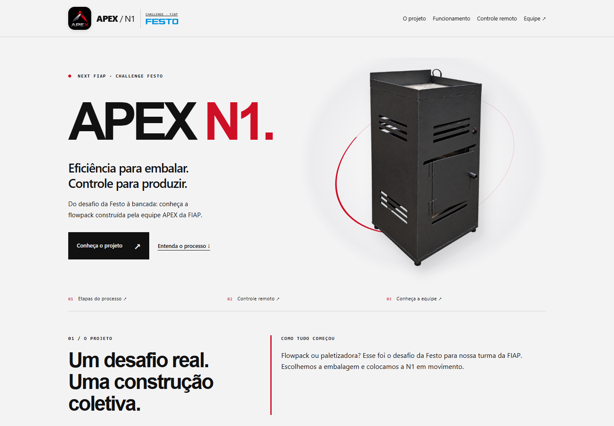

# APEX N1

[Português](#português) · [English](#english)

## Português

Landing page da máquina flowpack desenvolvida pela equipe APEX da FIAP para o Challenge Festo. O site apresenta o projeto, o fluxo de embalagem, o painel web, o controle portátil com ESP e LCD e os cinco integrantes.

[Acesse o site](https://gabocardo.github.io/apex-n1/)

## Tecnologias

HTML, CSS e JavaScript.

## Testar localmente

1. Baixe ou clone este repositório.
2. Abra `index.html` no navegador.
3. Para editar os textos, altere `index.html`. Os estilos estão em `styles.css` e as interações em `script.js`.
4. Mantenha as imagens na pasta `assets`.

## GitHub Pages

O site é publicado pelo GitHub Pages a partir da branch `main`.

1. Envie os arquivos atualizados para a branch `main`.
2. Em **Settings → Pages**, selecione **Deploy from a branch**, branch `main` e pasta `/(root)`.
3. Confira a conclusão da publicação na aba **Actions**.
4. Abra https://gabocardo.github.io/apex-n1/ para conferir o resultado.

---

## English

Landing page for the flowpack machine developed by FIAP's APEX team for the Festo Challenge. The website presents the project, the packaging process, the web dashboard, the portable ESP and LCD controller, and the five team members.

[Visit the website](https://gabocardo.github.io/apex-n1/en.html)

### Technologies

HTML, CSS and JavaScript.

### Test locally

1. Download or clone this repository.
2. Open `index.html` in your browser.
3. To edit the text, modify `index.html`. Styles are in `styles.css` and interactions are in `script.js`.
4. Keep images in the `assets` folder.

### GitHub Pages

The website is published through GitHub Pages from the `main` branch.

1. Upload the updated files to the `main` branch.
2. Under **Settings → Pages**, select **Deploy from a branch**, the `main` branch and the `/(root)` folder.
3. Check the **Actions** tab to confirm that deployment is complete.
4. Open https://gabocardo.github.io/apex-n1/ to view the result.
